# Skyward for the Xiaomi 15 Pro

English | [简体中文](README.zh-CN.md)

Skyward is a recovery written in Rust, from scratch. This fork is built for one
phone: **Xiaomi 15 Pro (`haotian`)**, on the Chinese system's OS4.0.0.19.

<p align="center">
  
  
  
</p>

## Features

### Dual boot

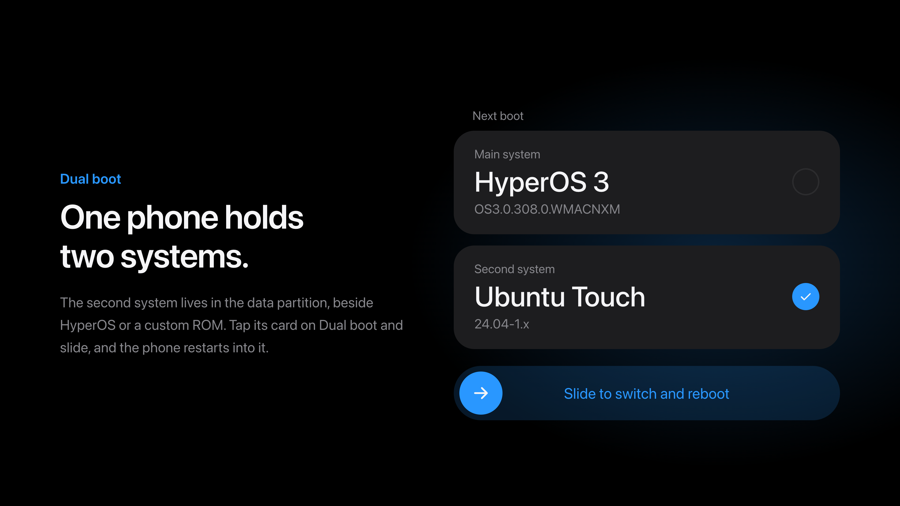

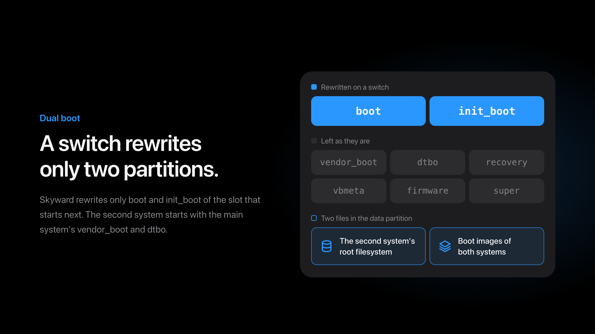

How a second system is packaged and started is in
[How dual boot works](#how-dual-boot-works).

### Decryption

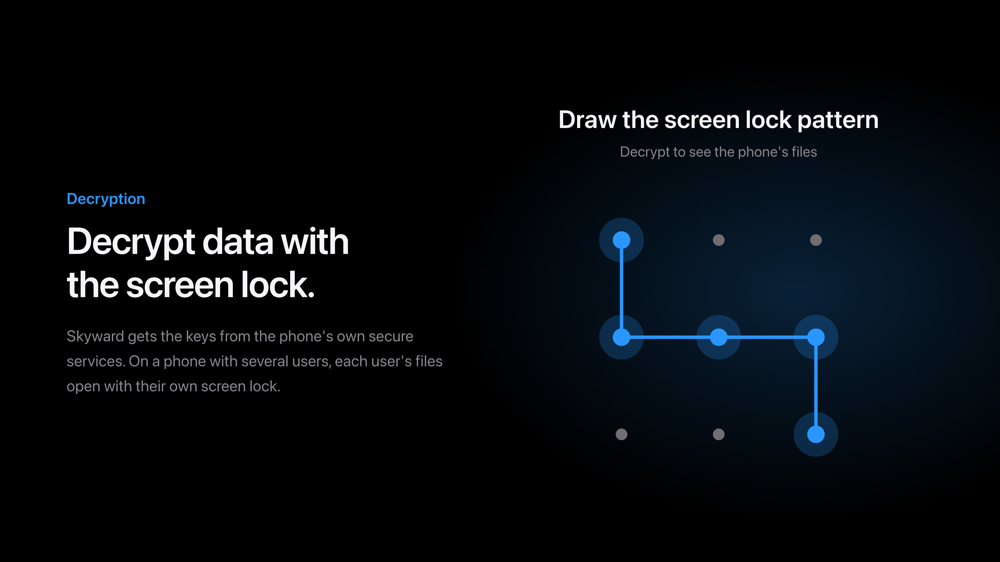

On this phone the secret may be guarded by the secure element's weaver, which a
recovery reaches only after `ssgtzd`, the eSE's two drivers and the element's HAL
are up. This fork starts all of them. See
[What this fork adds](#what-this-fork-adds-to-upstream).

### Installing

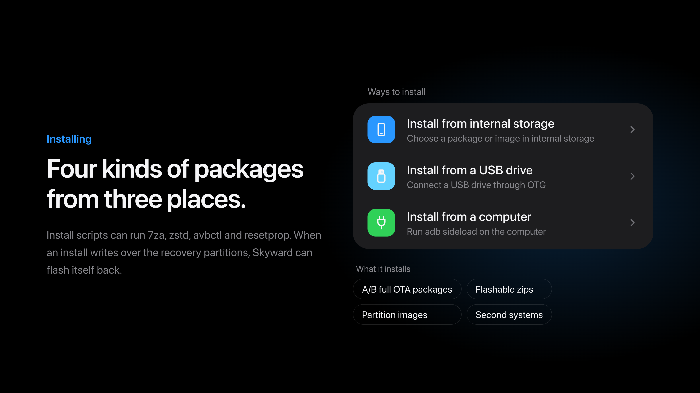

Install scripts get `7za` and `zstd`, which ROMs with a super image compressed by
zstd use to flash it, and an `unzip` whose `-p` streams the image as it reads it.
They also get `avbctl` and `resetprop`, to turn off verified boot's checks and to
read and set properties.

### Online updates

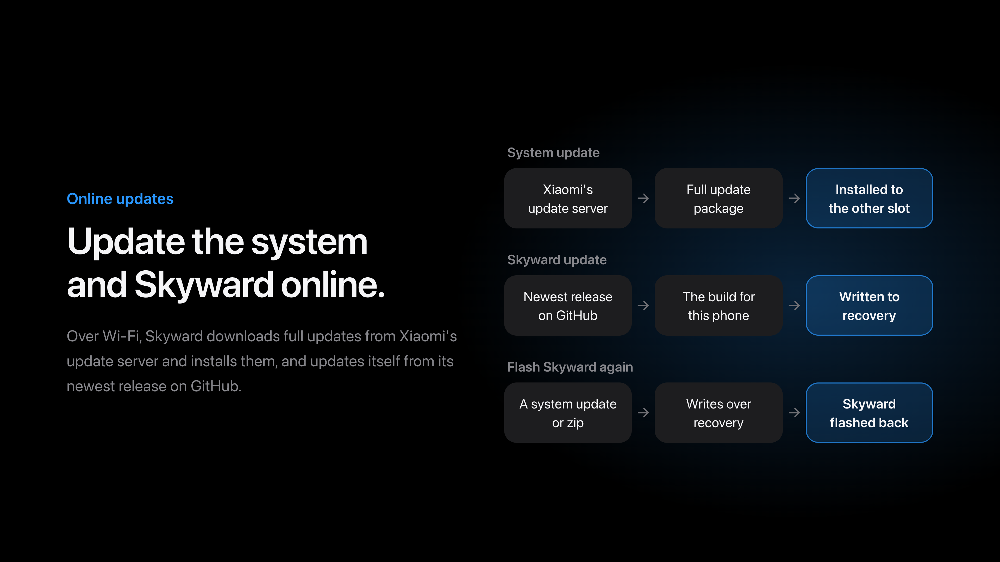

Skyward's own updates come from the newest release in
[this repository](https://github.com/Rinrroy/skyward-for-haotian/releases), as
the image itself rather than a zip.

A download can be paused and continued, and a package already downloaded can be
deleted. A pause is only a stop: what was fetched stays as the `.part` it is,
and continuing asks the server for the rest of it from that file's real length.

The check and the download both go to GitHub first; a mirror in the mainland
(`gh-proxy`, `ghfast`, `ghproxy`, `api.kkgithub.com`) is tried only when GitHub
does not answer, and whatever a mirror sends still has to match the release's
SHA-256. The switch is under Settings → Updates and is on by default.

### Backup and restore

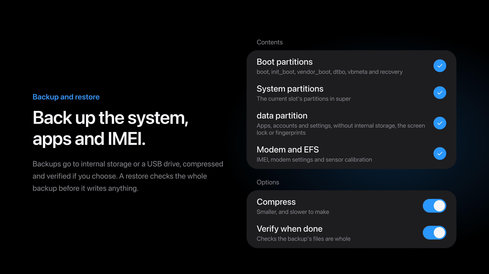

### File manager

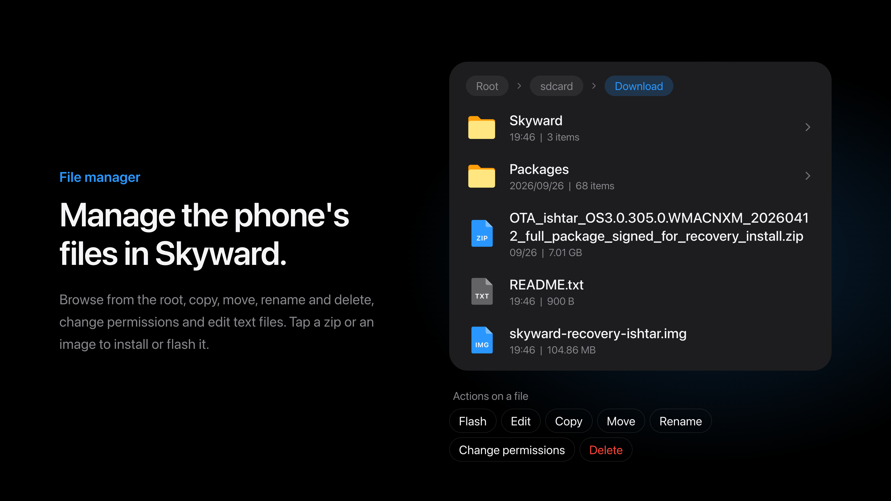

The list sorts by name, modified time or file type, and the file manager has its
own way in on the home page beside install and backup. Folders stay first in all
three, and every order is total — ties fall to the lowercased name and then the
raw one — so no entry is left where the filesystem happened to return it.

A search box above the list keeps only the names that contain what is typed,
ignoring case; it is pinned under the bar, so scrolling cannot take it away, and
the keyboard it brings up sits at the bottom of the same page. The search walks the
folders *below* the one on the page too, and each row names the folder its entry is
in; a file found opens on its own page, a folder found goes into it. The walk is
capped (2000 folders, 40000 entries, 200 results, 12 levels) so it can never hang
the screen, and unreadable folders are skipped. The order is one button beside the
box that turns on each tap — name, time, type — rather than three buttons that are
all there at once.

### Terminal

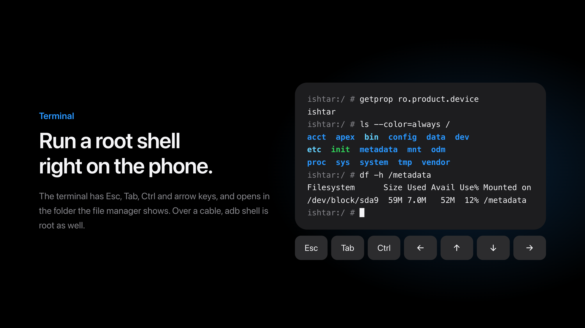

### Connecting a computer

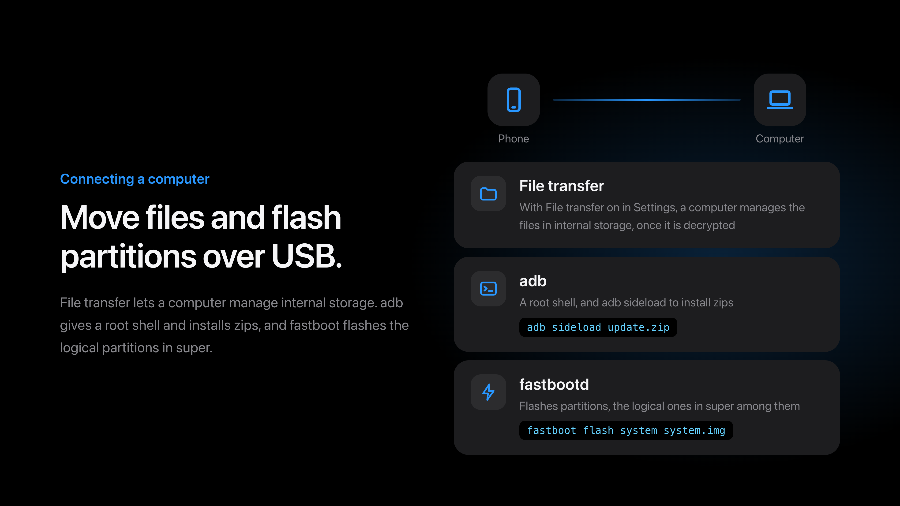

### Wiping data

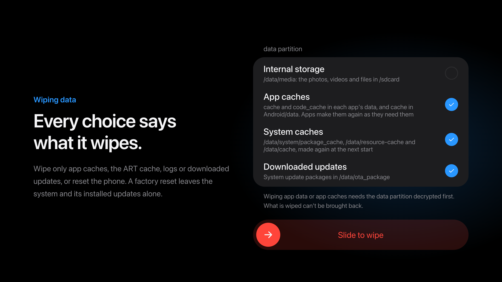

### Replacing the stock recovery

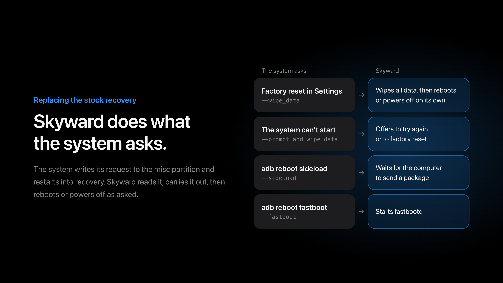

### Search

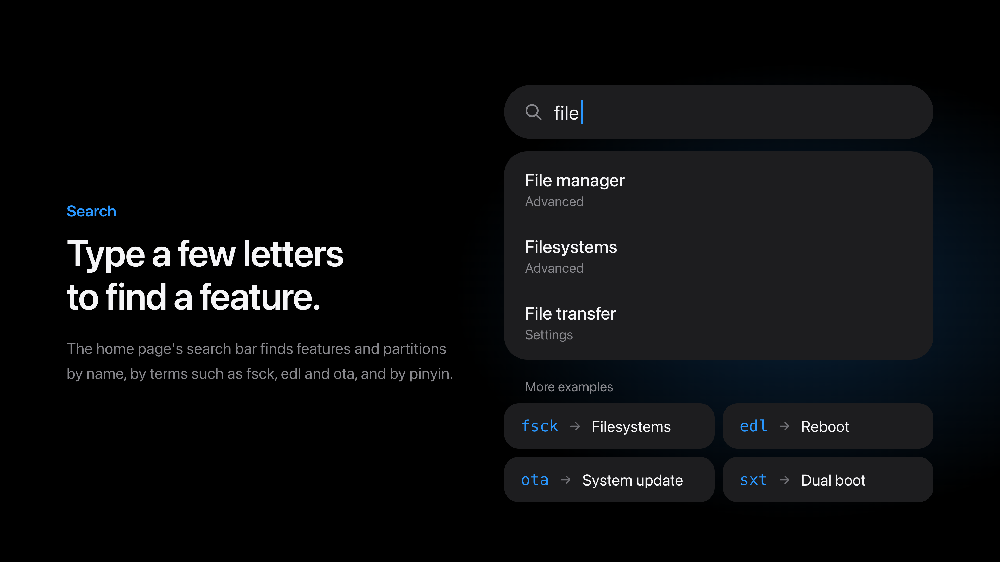

### Advanced

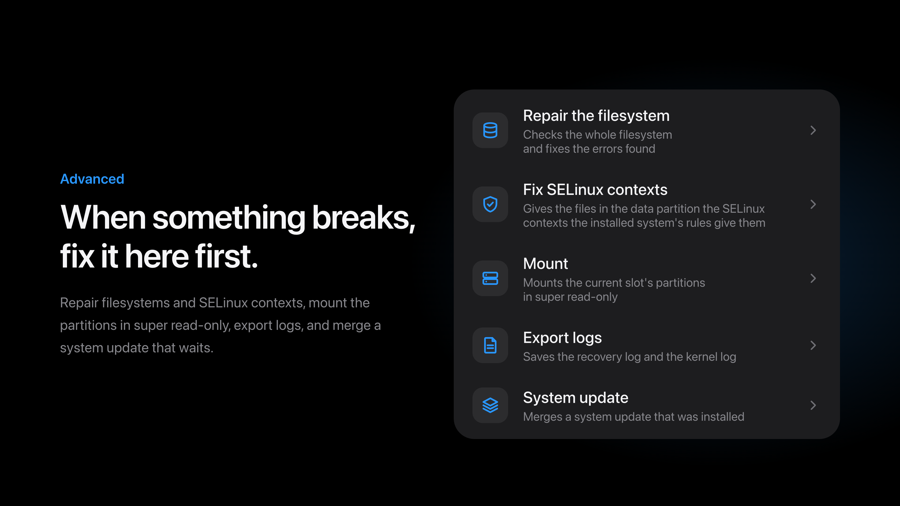

Turning AVB verification off takes two confirmations: the first swipe says what
a bootloader that checks nothing means, and only the second writes. The running
slot's `vbmeta` can be kept to internal storage or a USB drive and given back —
but only when the copy's rollback index is **not below** the slot's own, because
writing an older one back is exactly what makes a bootloader refuse to start
this slot. There is no override.

### About phone

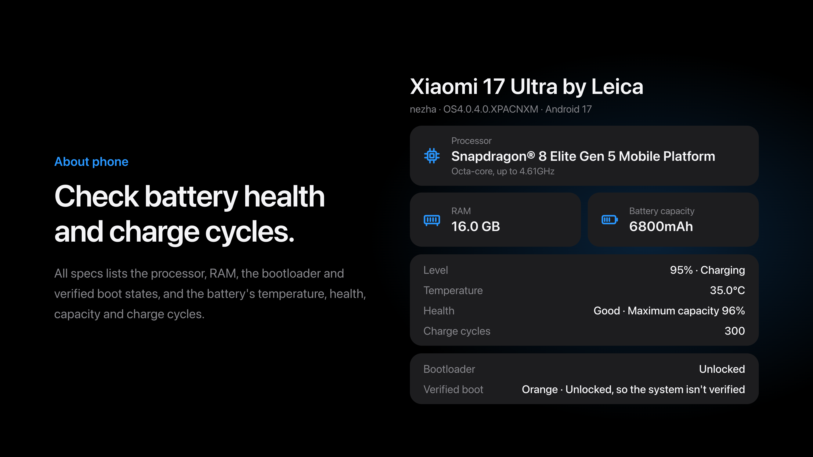

### Other features

- Reboot to system, recovery, fastboot, bootloader or EDL, switch slots, or turn
  the phone off from a page of its own
- Light and dark themes; Simplified Chinese, Traditional Chinese and English
- Mount partitions, repair and format filesystems
- WLAN, MTP file transfer, adb and fastbootd; a network joined once is
  remembered and can be forgotten from the list
- A plugins page, with its own way in on the home page: a plugin is a folder with
  a `plugin.json`, and one that names an image can be downloaded from its own
  release and run — the browser is the first of those. The phone hands its
  display to it, and these pages come back when it exits. The download takes the
  same mainland mirror as the system update, and is checked against its SHA-256
  either way; an image fetched in the system and copied into `Skyward/plugins`
  works without a manifest. Deleting one is asked for the way a downloaded
  system package is. See [docs/plugins/webview.md](docs/plugins/webview.md)

### Without a system

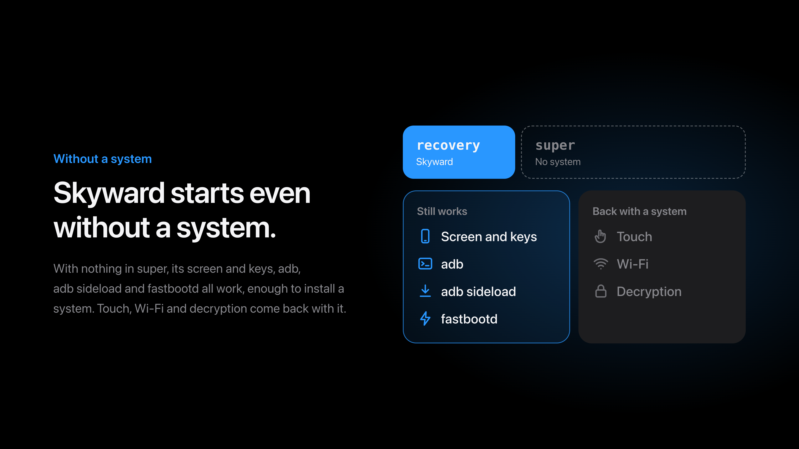

## What this fork adds to upstream

Upstream Skyward is a multi-device recovery. This fork keeps its own
`devices/haotian.toml` only, and adds what this phone's hardware turned out to
need:

- **The weaver answers, so a data partition that is only weaver-bound opens.**
  A phone whose secret is guarded by the secure element's weaver reaches it
  through three things a recovery does not run by itself, and all three are now
  started or loaded by Skyward:
  - `ssgtzd`, the TEE's mink daemon. Without it the secure element's
    `TEEC_OpenSession` returns `0xFFFF0000` and the element never opens.
  - `stm_st54se_gpio` and `stm_nfc_i2c`, so `/dev/st54spi_gpio` exists at all.
  - The secure element's HAL as `root`, after the ADSP is up.
- **The screen's colours are right.** This panel is a pen tile one that leaves
  subpixel rendering to the display controller, so the controller is told the
  layout through `SDE_SPR_INIT_CFG_V2`; without it every colour arrives as
  `(B, G, B)`.
- **Two taps light the dark panel**, as the phone's own system's double tap does.
  It is a switch on the settings page and ships **off**: the taps are only felt
  while the panel keeps dozing — this driver suspends the touchscreen with the
  panel's blanking — so turning it on costs the phone its suspend.
- **The ADSP is given three seconds, then asked for a retry.** On a build whose
  `/vendor/firmware` carries only the first part of the DSP's firmware, the
  kernel stops at the first missing segment; Skyward asks the loader again once
  the modem partition is shown at `/firmware`, which is the last folder the
  kernel's own firmware search looks in.
- **What ART compiled is cleared once per image.** A recovery flashed over the
  system leaves behind code compiled for the system it replaced; the first start
  of a new image clears it so the phone compiles its own again.
- **The lock screen read is the one the phone has now.** `locksettings.db` is
  written in SQLite's write-ahead log mode, so the newest protector can still be
  in its `-wal` file; Skyward reads a copy with that log folded in.

## Supported devices

| Device | Codename | Built on | Tested |
| --- | --- | --- | --- |
| Xiaomi 15 Pro | `haotian` | OS4.0.0.19.XOBCNXM (Android 17) | yes |

### Not implemented

- Updates whose snapshots are compressed and served by `snapuserd`: this
  recovery maps and merges kernel snapshots only
- Incremental update packages
- Update packages for phones without A/B slots

## Notes on the Xiaomi 15 Pro

These have been tried on the phone and work: the screen (including its subpixel
rendering, which this panel leaves to the display controller), the touchscreen,
adb and fastbootd, MTP, the motor, WLAN, and decrypting the data partition with
the screen lock's credential.

The stock build the image is made on is OS4.0.0.19.XOBCNXM.

### If decryption still fails

The kernel log says which of the three walls was hit. Look for the line
`the blob the phone records is bound to a weaver; the blobs beside it are …`,
then:

- `the phone's weaver cannot answer` — the transport: `ssgtzd`, the eSE's
  drivers, or the secure element's HAL.
- `the secure element does not recognise that credential` — the credential.
- `the secure element is holding off further tries` — the element's own
  throttling, after repeated wrong tries.

If the DSP is the fault, the kernel log carries `the ADSP is offline; asked the
loader again now that /firmware is in place`, followed by either a running DSP
or `it is not running, even after the loader was asked again`.

### Why the double tap costs power

Xiaomi's touch driver follows the display's blanking notices and suspends the
touch IC on them (`FB_BLANK POWER DOWN` → `xiaomi_touch_suspend_work`). From
then on the touchscreen reports nothing at all while the panel is dark. So a
phone that must feel a tap has to keep its panel dozing rather than taking it
down — and a dozing panel is a phone that never suspends. That is why the
gesture ships off: least power is what a recovery should do unless asked
otherwise.

## Installing Skyward

Skyward needs an unlocked bootloader. Download the image from
[Releases](https://github.com/Rinrroy/skyward-for-haotian/releases), check it
against `SHA256SUMS`, and flash it to the recovery partition of the slot the
phone runs from, with the phone in fastboot mode:

```sh
sha256sum --check SHA256SUMS
fastboot flash recovery skyward-v0.2.4-haotian-OS4.0.0.19.XOBCNXM.img
fastboot reboot recovery
```

Afterwards Skyward updates itself over Wi-Fi from the newest release **in this
repository**, on the Skyward update page in Settings; a newer image also installs
from its own Install page. With **Flash Skyward again** on, a system update or
zip that writes over the recovery partitions gets Skyward back in them.

The update page asks `api.github.com/repos/Rinrroy/skyward-for-haotian` for its
newest release, and takes the asset named `skyward-<tag>-haotian-<stock>.img` —
the image itself, published as it is rather than zipped. A fork of this fork has
to change `skyward_net::github::LATEST` to its own repository, or the phone will
be offered images built for `haotian` that it cannot use.

Without a system in super, Skyward still starts, with its screen and keys, adb,
`adb sideload` and fastbootd, enough to install one. Touch, WLAN and decryption
run from the installed system and come back with it.

adb in Skyward is a root shell that needs no authorization on the phone: anyone
with the phone and a cable can reach its storage while it is in recovery.

## How dual boot works

Skyward installs a second system beside the one in the phone's own partitions,
whether that is HyperOS or a custom ROM, and switches between them from **Dual
boot** on its home page. The second system's root is a file in the data partition
that the filesystem may neither move nor delete, read and written through the
partition itself; the boot images of both systems are kept in another such file.
A switch writes only the boot and init_boot partitions of the slot that starts
next, and keeps each step on /metadata first, so a switch cut off by a loss of
power is finished when Skyward next starts. vendor_boot, dtbo, recovery, vbmeta,
the firmware and super stay as they are, and the second system starts with the
installed system's vendor_boot and dtbo.

Before anything else writes the boot partitions, Skyward puts the installed
system's boot images back: an install, a slot switch, fastboot, a factory reset,
and a backup or restore of the boot partitions. The second system waits while a
system update is still to be merged, and backups of the data partition leave it
out.

A second system installs from a zip on the Install page, as any other package
does:

| File | What it holds |
| --- | --- |
| `system.toml` | `id`, `name`, `version` and `filesystem`; `init`, the program the root starts with, `/sbin/init` unless given; `minimum`, the least room the root takes, in bytes |
| `boot.img` | The kernel the bootloader starts |
| `rootfs.img` | The root filesystem's image, of the `filesystem` named |
| `init_boot.img` | Only for a system with a first ramdisk of its own |

A system without an init_boot image of its own starts from one Skyward makes. Its
program loads the installed system's first-stage kernel modules the way that
system's first stage loads them, with their soft dependencies and the settings
the kernel command line gives them, finds the root in the data partition, mounts
it and starts `init` there. If anything stops it, it brings Skyward up, as a
failed start of the installed system ends in the recovery: it leaves the reason
in misc, unpacks the ramdisk of the slot's recovery partition over its own, as
the kernel unpacks it when the bootloader starts the recovery, and hands over to
Skyward's first program, so Skyward comes up however the bootloader treats a
restart. Skyward shows why, and the second system still starts next until the
user switches on Dual boot. A start that stops moving restarts into the recovery
instead, and a phone restarted before the hand-over finds the same request in
misc at its next start, which brings Skyward up before anything else. Where
Skyward comes up neither way, the phone stays where it stopped, and never starts
the same again and again. A system with a first ramdisk of its own finds
Skyward's program at `/skyward/map`, which lays the root out as a block device
and prints its node. Each switch to the second system writes its init_boot image
with the program of the Skyward that switches, so an updated Skyward starts it
with the new program.

A running system switches by writing `boot-recovery` with
`--switch_system=installed`, or `--switch_system=` and the second system's `id`,
to misc, and restarting into recovery. Where the bootloader starts the slot again,
as the 13 Ultra's can with a USB cable in, Skyward's program finds the request in
misc at the next start and brings Skyward up before anything else.

## Building

Skyward builds with the stable Rust that `rust-toolchain.toml` names, with its
`aarch64-linux-android` target, the Android NDK and
[cargo-ndk](https://github.com/bbqsrc/cargo-ndk). The recovery service and the
second system's first program are built for the phone, and the packer for the
computer:

```sh
cargo ndk -t arm64-v8a --platform 30 build --release -p skyward
RUSTFLAGS="-C target-feature=+crt-static" cargo ndk -t arm64-v8a --platform 30 build --release -p skyward-system-init --target-dir target/system-init
cargo build --release -p skyward-pack
```

The packer takes the stock recovery partition out of the build's full update
package on Xiaomi's server, reading only the part of the package the partition
is in, and checks its SHA-256 against the device file:

```sh
target/release/skyward-pack stock --config devices/haotian.toml --out target/stock/haotian/recovery.img
target/release/skyward-pack stock --config devices/haotian.toml --out target/stock/haotian/recovery.img --partition odm
```

Then it builds the image on top of it:

```sh
target/release/skyward-pack recovery \
  --stock target/stock/haotian/recovery.img \
  --binary target/aarch64-linux-android/release/skyward \
  --system-init target/system-init/aarch64-linux-android/release/system-init \
  --config devices/haotian.toml \
  --font resources/fonts/MiSansVF.ttf \
  --mono resources/fonts/KirkMono-Regular.ttf \
  --mono-license resources/fonts/KirkMono-OFL.txt \
  --firmware cs40l26.wmfw=stock/firmware/cs40l26.wmfw \
  --firmware cs40l26.bin=stock/firmware/cs40l26.bin \
  --firmware cs40l26-svc.bin=stock/firmware/cs40l26-svc.bin \
  --firmware cs40l26-dvl.bin=stock/firmware/cs40l26-dvl.bin \
  --firmware cs40l26-dbc.bin=stock/firmware/cs40l26-dbc.bin \
  --firmware cs40l26-a2h.bin=stock/firmware/cs40l26-a2h.bin \
  --omapi resources/omapi \
  --out target/skyward-haotian.img
```

The motor's firmware has to be in the ramdisk before init's first probe, and
`--omapi` puts in the OMAPI service the Thales weaver reaches the secure element
through. `.github/workflows/build-haotian.yml` does all of this on a tag and
publishes the image with its checksum.

Tests and lints run on the computer; what runs only on the phone is linted for
it:

```sh
cargo test --workspace
cargo clippy --workspace --all-targets -- -D warnings
cargo ndk -t arm64-v8a --platform 30 clippy -p skyward -p skyward-install -p skyward-systems -p skyward-system-init -- -D warnings
```

A Windows host can cross-compile the phone's side and run the tests for
`skyward-config`, but neither packs an image (`skyward-bootimg` uses unix-only
calls) nor builds `skyward-ui`'s tests (`rsproperties` does not build there).
Use Linux or CI for those.

`skyward-preview` draws the pages on the computer, as PNG files, without a
phone. `--lang` picks the language by a locale such as `en` or `zh-TW`:

```sh
cargo run --release -p skyward-preview -- target/preview --lang en
```

## Reading this repo

`AGENT.md` is the working notes: what each part costs to learn, the rules a
diagnostic has to keep, and — for this phone — why the weaver, the ADSP, the
panel's colours and the two-tap wake behave the way they do. Commit messages
explain *why*, often at length.

## License

[GPL-3.0-or-later](LICENSE)
