# Skyward for the Xiaomi 15 Pro

[English](README.md) | 简体中文

Skyward 是使用 Rust 编写的 recovery，从零开始编写。本分支只为一台手机构建：
**Xiaomi 15 Pro（`haotian`）**，基于中国版系统 OS4.0.0.19。

<p align="center">
  
  
  
</p>

## 功能

### 双系统

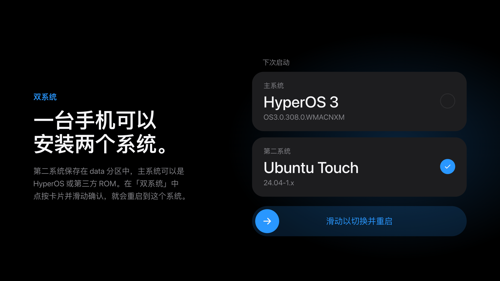

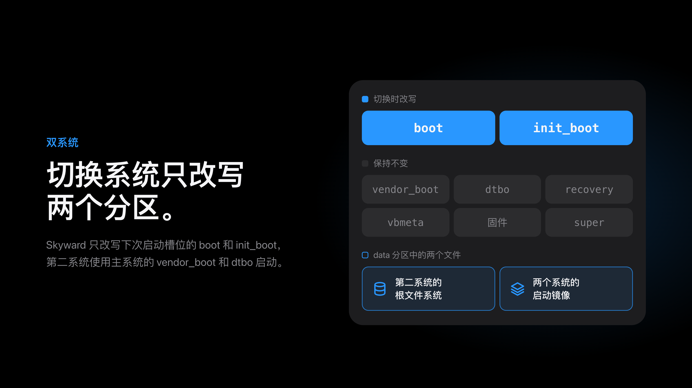

第二系统的安装包格式和启动过程见下文的[双系统的工作方式](#双系统的工作方式)。

### 解密

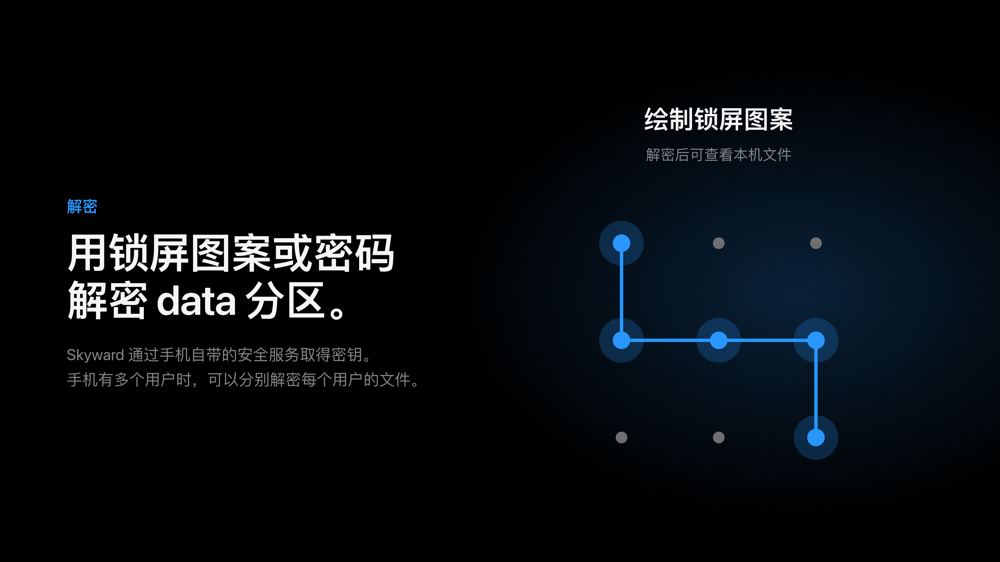

在这台手机上，密钥可能由安全元件的 weaver 保管，而 recovery 需要在 `ssgtzd`、
eSE 的两个驱动和安全元件的 HAL 都起来之后才能访问它。本分支会全部启动它们，见
[本分支在上游基础上增加的内容](#本分支在上游基础上增加的内容)。

### 安装

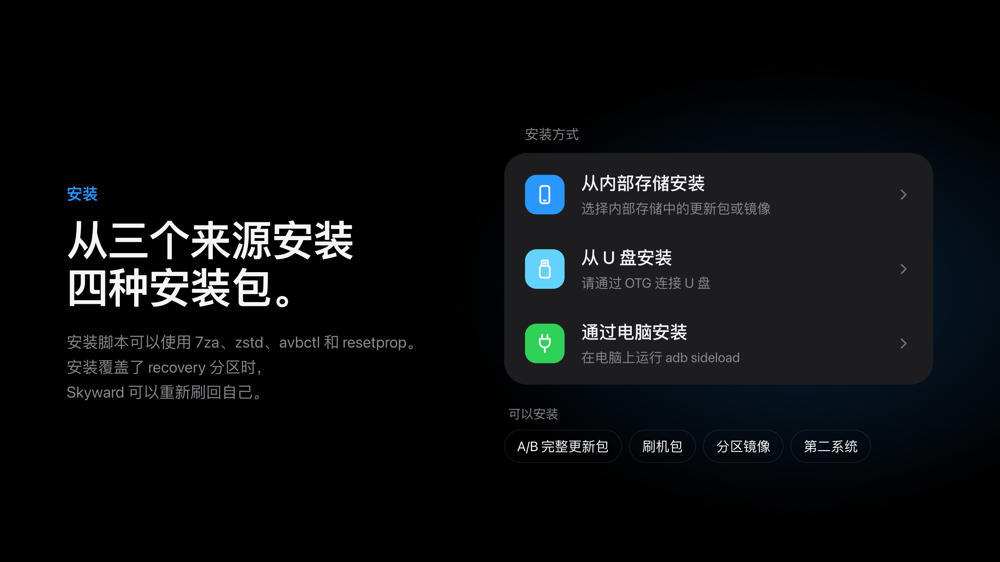

刷机包的安装脚本可以使用 `7za` 和 `zstd`，支持刷入 super 镜像使用 zstd 压缩的第三方 ROM；`unzip -p` 边解压边输出镜像。安装脚本还可以使用 `avbctl` 关闭验证启动的校验，使用 `resetprop` 读取和设置属性。

### 在线更新

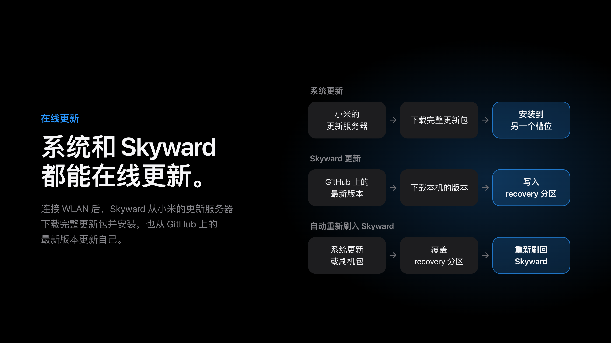

Skyward 自身的更新来自[本仓库](https://github.com/Rinrroy/skyward-for-haotian/releases)
的最新版本，并且资产就是镜像本身，不再套一层 zip。

下载可以暂停再继续，下载完的安装包也可以删除。暂停只是停下不再写：已经下载的
部分就留在那里成为 `.part`，继续时按这个文件的**实际长度**向服务器要剩下的部分。

检查和下载都是先去 GitHub，连不上时才试国内的镜像（`gh-proxy`、`ghfast`、
`ghproxy` 和 `api.kkgithub.com`），镜像给回来的字节仍然要对得上发行版里的
SHA-256。开关在「设置 → 更新来源」，默认开着。

### 备份和恢复

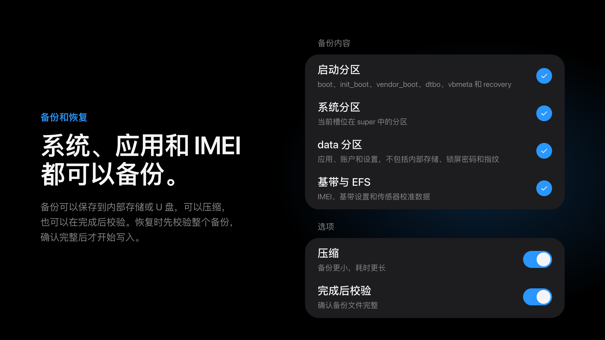

### 文件管理

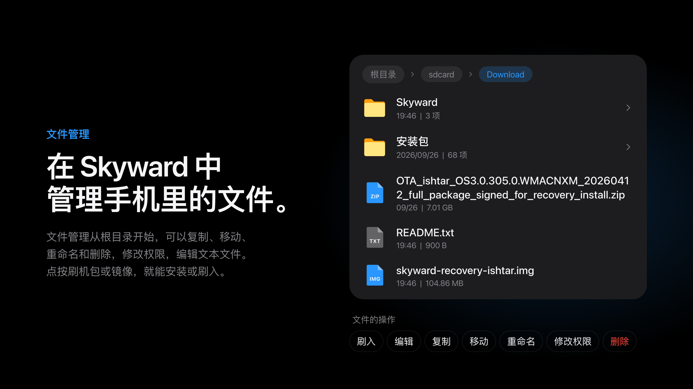

列表可以按名称、修改时间或文件类型排序，用的那条在列表下面。三种排序里文件夹
都排在最前，而且比较是**全序**——名称相同的再按小写名、再按原始字节比，所以不会
有文件停在文件系统返回的任意位置上。

列表上方还有一个**搜索框**，输入什么就只留下名字含它的条目（不区分大小写）；它固定
在标题栏下面，滚动带不走，弹出的键盘在同一个页面底部。搜索**不只搜当前这一层**：
它会往下走子文件夹，结果每一行下面用小字标出所在文件夹；找到的文件直接打开信息页，
找到的文件夹直接进去。往下走有上限（2000 个文件夹、40000 个条目、200 条结果、12 层），
所以永远不会卡住界面，读不了的文件夹跳过。排序是搜索框右边**一个按钮**，
点一次换一种（名称 → 时间 → 类型），不再是三个并排的选项。

### 终端

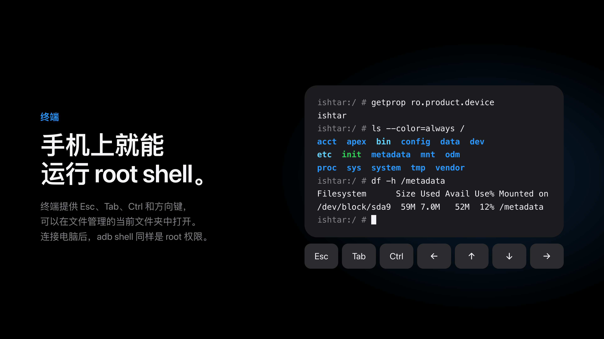

### 连接电脑

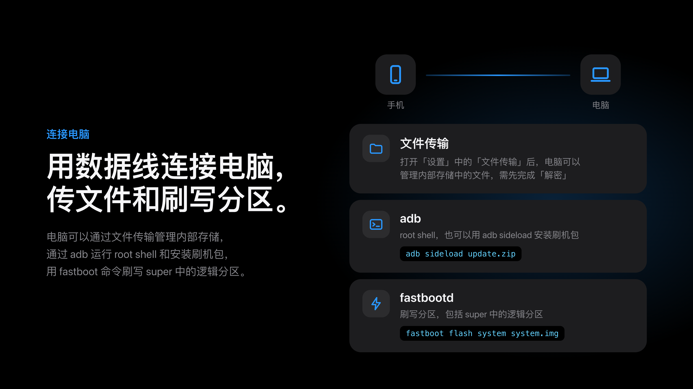

### 清除数据

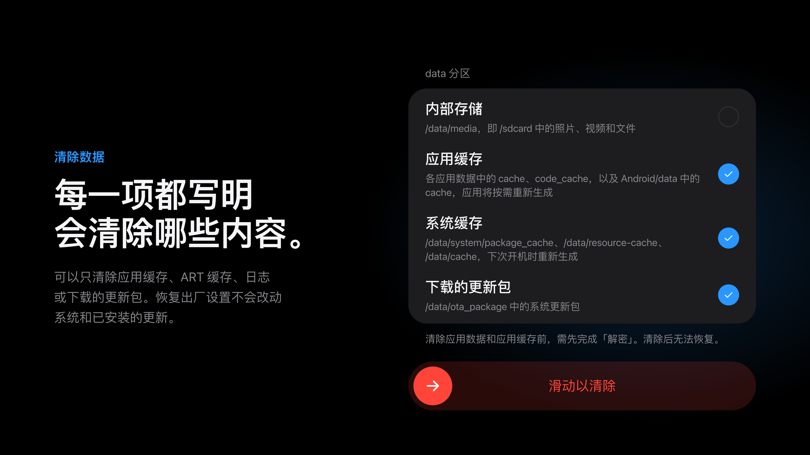

### 替换原厂 recovery

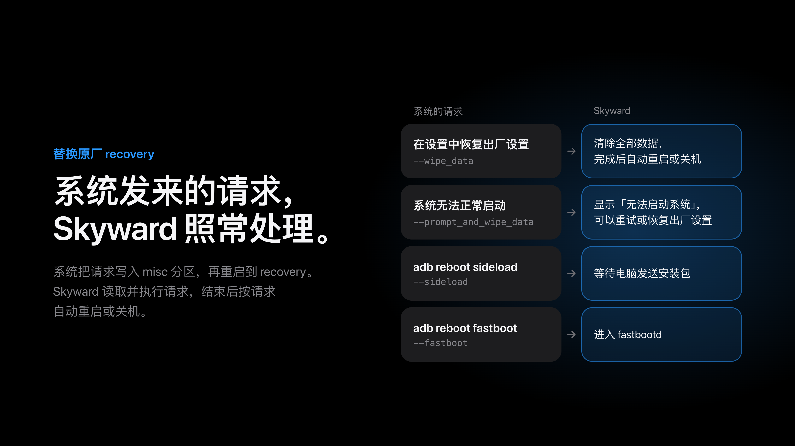

### 搜索

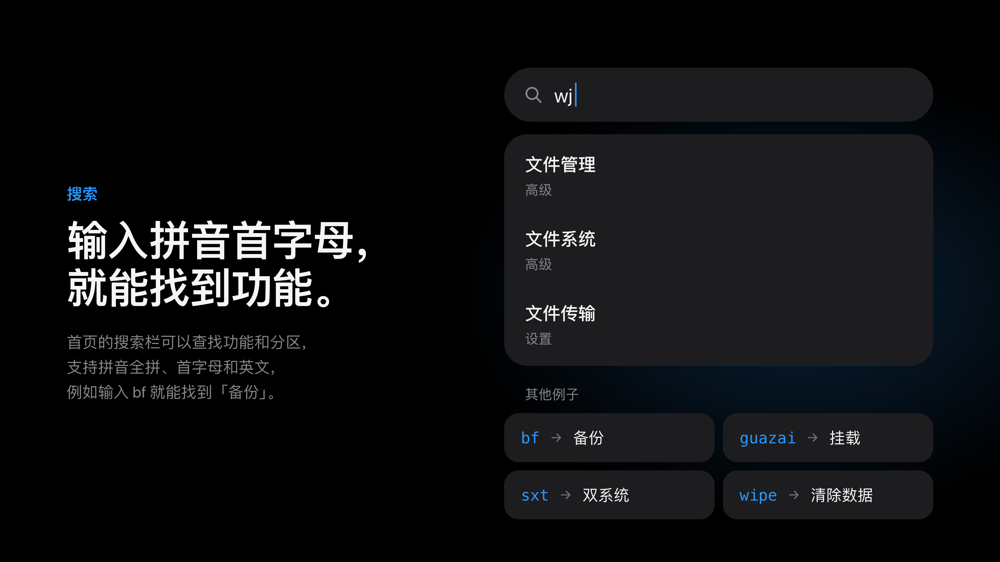

### 高级

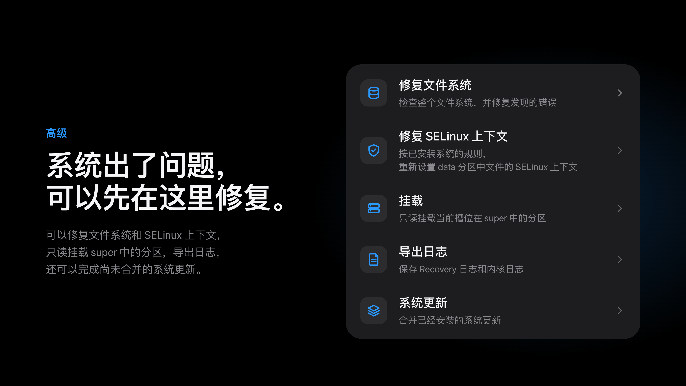

关闭 AVB 校验需要**两次确认**：第一次滑动只是说明引导器不再校验意味着什么，
第二次才真正写入。当前槽位的 `vbmeta` 可以存到内部存储或 U 盘，也可以写回——
但只有副本的回滚索引**不低于**手机现在这个槽位的值时才允许写回，因为写回一个更
旧的正是让引导器拒绝启动本槽位的原因。没有「强制写入」。

### 关于手机

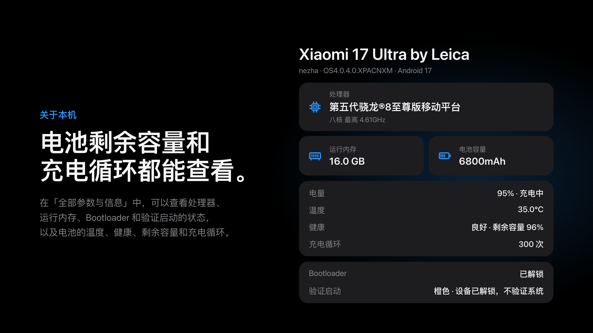

### 其他功能

- 重启到系统、recovery、fastboot、bootloader 或 EDL，切换槽位，以及在单独的
  页面上关机
- 浅色与深色主题；简体中文、繁体中文与英文
- 挂载分区、修复和格式化文件系统
- WLAN、MTP 文件传输、adb 与 fastbootd；连过一次的网络会被记住，也可以在列表
  里忘记它
- 插件页：插件是一个带 `plugin.json` 的文件夹；写明镜像的插件可以从它自己的
  release 下载并运行，浏览器就是第一个。运行期间手机把屏幕交给它，它退出后回到
  这些页面。见 [docs/plugins/webview.md](docs/plugins/webview.md)

### 没有系统时

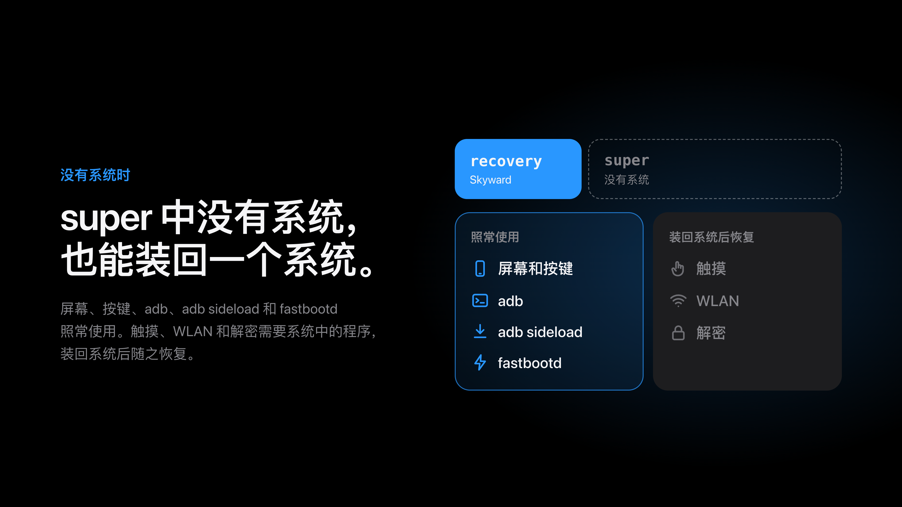

## 本分支在上游基础上增加的内容

上游 Skyward 是支持多机型的 recovery。本分支只保留自己的 `devices/haotian.toml`，
并补上这台手机的硬件实际需要的东西：

- **weaver 能应答了，因此只绑定 weaver 的 data 分区也能打开。** 密钥由安全元件
  的 weaver 保管的手机，要经过三样 recovery 自己不会运行的东西才能访问它，现在
  这三样都由 Skyward 启动或加载：
  - `ssgtzd`，TEE 的 mink 守护进程。没有它，安全元件的 `TEEC_OpenSession` 返回
    `0xFFFF0000`，元件根本打不开。
  - `stm_st54se_gpio` 和 `stm_nfc_i2c`，`/dev/st54spi_gpio` 才会存在。
  - 安全元件的 HAL 以 `root` 运行，且在 ADSP 起来之后。
- **屏幕颜色是对的。** 这块面板是 pen tile 的，把亚像素渲染交给显示控制器，所以
  通过 `SDE_SPR_INIT_CFG_V2` 告诉控制器点阵怎么排；不写这一段，所有颜色都会以
  `(B, G, B)` 到达。
- **双击点亮息屏的面板**，与手机自身系统的双击一样。它是设置页里的一个开关，且
  **默认关闭**：只有在面板保持 doze 时才能感觉到轻点——这个驱动会随面板熄屏通知
  把触摸 IC 一起挂起——所以打开它就要付出不休眠的代价。
- **给 ADSP 三秒钟，然后请求重试。** 在 `/vendor/firmware` 只带 DSP 固件第一段
  的版本上，内核在第一个缺失的段停下；Skyward 在 modem 分区被显示到 `/firmware`
  之后再次请求加载器，那是内核自己固件搜索的最后一个文件夹。
- **每个镜像清一次 ART 缓存。** recovery 刷在系统之上，会留下为旧系统编译的代码；
  新镜像第一次启动时清掉，让手机重新编译自己的。
- **读到的锁屏密码就是当前的那个。** `locksettings.db` 用 SQLite 的 WAL 模式写入，
  最新的 protector 可能还在 `-wal` 里；Skyward 读的是把日志合并进去的副本。

## 支持的机型

| 机型 | 代号 | 基于 | 已验证 |
| --- | --- | --- | --- |
| Xiaomi 15 Pro | `haotian` | OS4.0.0.19.XOBCNXM (Android 17) | 是 |

### 尚未实现

- 快照被压缩并由 `snapuserd` 提供的更新：本 recovery 只映射和合并内核快照
- 增量更新包
- 没有 A/B 槽位的手机的更新包

## Xiaomi 15 Pro 上的注意事项

这些都在真机上试过并且可用：屏幕（包括它交给显示控制器做的亚像素渲染）、触摸屏、
adb 与 fastbootd、MTP、马达、WLAN，以及用锁屏密码解密 data 分区。

镜像所基于的原厂版本是 OS4.0.0.19.XOBCNXM。

### 如果解密仍然失败

内核日志会说明撞上了三道墙中的哪一道。找这一行
`the blob the phone records is bound to a weaver; the blobs beside it are …`，
然后：

- `the phone's weaver cannot answer` —— 传输层：`ssgtzd`、eSE 的驱动，或安全元件
  的 HAL。
- `the secure element does not recognise that credential` —— 凭据本身。
- `the secure element is holding off further tries` —— 元件自己的限流，在反复输错
  之后。

如果问题出在 DSP，内核日志会带
`the ADSP is offline; asked the loader again now that /firmware is in place`，
之后要么 DSP 已运行，要么是 `it is not running, even after the loader was asked again`。

### 双击为什么费电

小米的触摸驱动跟随显示器的熄屏通知，并据此挂起触摸 IC（`FB_BLANK POWER DOWN` →
`xiaomi_touch_suspend_work`）。从那一刻起，面板黑着的时候触摸屏什么都不上报。所以
要点亮双击的手机，必须让面板保持 doze 而不是彻底断电——而面板保持 doze 就意味着
手机不休眠。这就是为什么这个手势默认关闭：除非有人要求，recovery 应当选最省电的做法。

## 安装 Skyward

Skyward 需要已解锁的 bootloader。从
[Releases](https://github.com/Rinrroy/skyward-for-haotian/releases) 下载镜像，
用 `SHA256SUMS` 校验，然后在 fastboot 模式下刷入手机当前槽位的 recovery 分区：

```sh
sha256sum --check SHA256SUMS
fastboot flash recovery skyward-v0.2.4-haotian-OS4.0.0.19.XOBCNXM.img
fastboot reboot recovery
```

之后 Skyward 可以在「设置」的更新页里通过 Wi-Fi 从**本仓库**的最新版本在线更新；
新镜像也可以从它自己的「安装」页刷入。开启**再次刷入 Skyward** 后，写入 recovery
分区的系统更新或刷机包会把 Skyward 重新装回去。

更新页向 `api.github.com/repos/Rinrroy/skyward-for-haotian` 询问最新版本，取名为
`skyward-<tag>-haotian-<stock>.img` 的资产——也就是镜像本身，直接以镜像发布，不再
套一层 zip。若你要再开一个分支，请改 `skyward_net::github::LATEST` 指向你自己的
仓库，否则手机会被推给为 `haotian` 构建、但它用不了的镜像。

super 里没有系统时，Skyward 仍会启动，屏幕、按键、adb、`adb sideload` 和 fastbootd
都在，足够装一个系统。触摸、WLAN 和解密都跑在已安装的系统上，会随它一起回来。

Skyward 里的 adb 是 root shell，手机上不需要授权：任何人拿着手机和数据线，就能在它
处于 recovery 时访问其存储。

## 双系统的工作方式

Skyward 在手机自身分区里的系统旁边安装第二个系统（无论是 HyperOS 还是第三方 ROM），
并在首页的**双系统**里切换。第二系统的根是 data 分区里的一个文件，文件系统既不能
移动也不能删除它，读写都通过分区本身完成；两个系统的 boot 镜像也存在另一个这样的
文件里。切换只写入下一个启动的槽位的 boot 和 init_boot 分区，并且每一步都先记在
/metadata 上，所以因断电中断的切换会在 Skyward 下次启动时完成。vendor_boot、dtbo、
recovery、vbmeta、固件和 super 都保持原样，第二系统用已安装系统的 vendor_boot 和
dtbo 启动。

在任何东西写入 boot 分区之前，Skyward 会先把已安装系统的 boot 镜像放回去：安装、
切换槽位、fastboot、恢复出厂设置，以及 boot 分区的备份或恢复。系统更新还没合并时
第二系统会等待，data 分区的备份则把它排除在外。

第二系统像其他安装包一样，从「安装」页的 zip 安装：

| 文件 | 内容 |
| --- | --- |
| `system.toml` | `id`、`name`、`version` 和 `filesystem`；`init`，根启动的程序，未指定时为 `/sbin/init`；`minimum`，根至少占用的空间，单位为字节 |
| `boot.img` | bootloader 启动的内核 |
| `rootfs.img` | 根文件系统的镜像，文件系统为 `filesystem` 指定的那一种 |
| `init_boot.img` | 仅用于自带第一个 ramdisk 的系统 |

没有自己 init_boot 镜像的系统，从 Skyward 生成的一个镜像启动。它的程序按该系统第一
阶段的方式加载已安装系统的第一阶段内核模块——带上软依赖和内核命令行给它们的设置——
在 data 分区里找到根，挂载它并在那里启动 `init`。如果中途停下，它会把 Skyward 拉
起来，就像已安装系统启动失败会进入 recovery 一样：它把原因留在 misc 里，把当前槽位
recovery 分区的 ramdisk 解压覆盖到自己上面（就像内核在 bootloader 启动 recovery 时
解压的那样），再交给 Skyward 的第一个程序，因此无论 bootloader 怎样对待一次重启，
Skyward 都能起来。Skyward 会显示原因，而第二系统仍然排在下一个启动，直到用户在
双系统里切换。卡住不动的启动改为重启进入 recovery；在交接前就被重启的手机会在下次
启动时在 misc 里找到同一个请求，这会先于一切把 Skyward 拉起来。两种情况都拉不起
Skyward 时，手机就停在它停下的地方，不会一次又一次地重复启动。自带第一个 ramdisk
的系统会在 `/skyward/map` 找到 Skyward 的程序，它把根铺成一个块设备并打印其节点。
每次切换到第二系统，都会用执行切换的那个 Skyward 的程序写入它的 init_boot 镜像，因此
更新后的 Skyward 会用新程序启动它。

运行中的系统通过向 misc 写入带 `--switch_system=installed` 或
`--switch_system=` 加第二系统 `id` 的 `boot-recovery`，然后重启进入 recovery 来切换。
在 bootloader 会重启该槽位的情况下（如插着数据线时的 13 Ultra），Skyward 的程序会在
下次启动时于 misc 里找到请求，并先于一切把它拉起来。

## 构建

Skyward 使用 `rust-toolchain.toml` 指定的 stable Rust 构建，需要
`aarch64-linux-android` 目标和 Android NDK，以及
[cargo-ndk](https://github.com/bbqsrc/cargo-ndk)。recovery 服务与第二系统的第一个
程序为手机构建，打包器为电脑构建：

```sh
cargo ndk -t arm64-v8a --platform 30 build --release -p skyward
RUSTFLAGS="-C target-feature=+crt-static" cargo ndk -t arm64-v8a --platform 30 build --release -p skyward-system-init --target-dir target/system-init
cargo build --release -p skyward-pack
```

打包器从小米服务器上的完整更新包里取出原厂 recovery 分区，只读取分区所在的那一部分，
并把它的 SHA-256 与设备文件里的值核对：

```sh
target/release/skyward-pack stock --config devices/haotian.toml --out target/stock/haotian/recovery.img
target/release/skyward-pack stock --config devices/haotian.toml --out target/stock/haotian/recovery.img --partition odm
```

然后在它之上构建镜像：

```sh
target/release/skyward-pack recovery \
  --stock target/stock/haotian/recovery.img \
  --binary target/aarch64-linux-android/release/skyward \
  --system-init target/system-init/aarch64-linux-android/release/system-init \
  --config devices/haotian.toml \
  --font resources/fonts/MiSansVF.ttf \
  --mono resources/fonts/KirkMono-Regular.ttf \
  --mono-license resources/fonts/KirkMono-OFL.txt \
  --firmware cs40l26.wmfw=stock/firmware/cs40l26.wmfw \
  --firmware cs40l26.bin=stock/firmware/cs40l26.bin \
  --firmware cs40l26-svc.bin=stock/firmware/cs40l26-svc.bin \
  --firmware cs40l26-dvl.bin=stock/firmware/cs40l26-dvl.bin \
  --firmware cs40l26-dbc.bin=stock/firmware/cs40l26-dbc.bin \
  --firmware cs40l26-a2h.bin=stock/firmware/cs40l26-a2h.bin \
  --omapi resources/omapi \
  --out target/skyward-haotian.img
```

马达的固件必须在 init 第一次探测之前就在 ramdisk 里；`--omapi` 会放入 Thales weaver
访问安全元件所经过的 OMAPI 服务。`.github/workflows/build-haotian.yml` 在打标签时
完成这些，并把镜像连同校验和一起发布。

测试与 lint 在电脑上运行；只跑在手机上的代码针对手机做 lint：

```sh
cargo test --workspace
cargo clippy --workspace --all-targets -- -D warnings
cargo ndk -t arm64-v8a --platform 30 clippy -p skyward -p skyward-install -p skyward-systems -p skyward-system-init -- -D warnings
```

Windows 主机可以交叉编译手机端，也能运行 `skyward-config` 的测试，但既不能打包镜像
（`skyward-bootimg` 用了仅 unix 的调用），也不能构建 `skyward-ui` 的测试（`rsproperties`
在那里构建不起来）。这些请用 Linux 或 CI。

`skyward-preview` 在电脑上把各页面画成 PNG，不需要手机。`--lang` 按 `en`、`zh-TW`
这样的 locale 选择语言：

```sh
cargo run --release -p skyward-preview -- target/preview --lang en
```

## 阅读本仓库

`AGENT.md` 是工作笔记：每一部分最费劲才学到的东西、诊断必须守的规则，以及——针对这
台手机——weaver、ADSP、面板颜色和双击唤醒为什么是这个样子。提交信息解释*为什么*，
往往写得很长。

## 许可证

[GPL-3.0-or-later](LICENSE)
